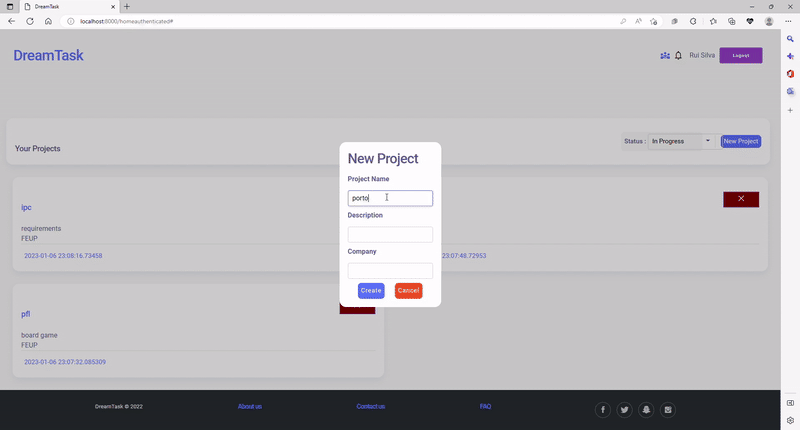
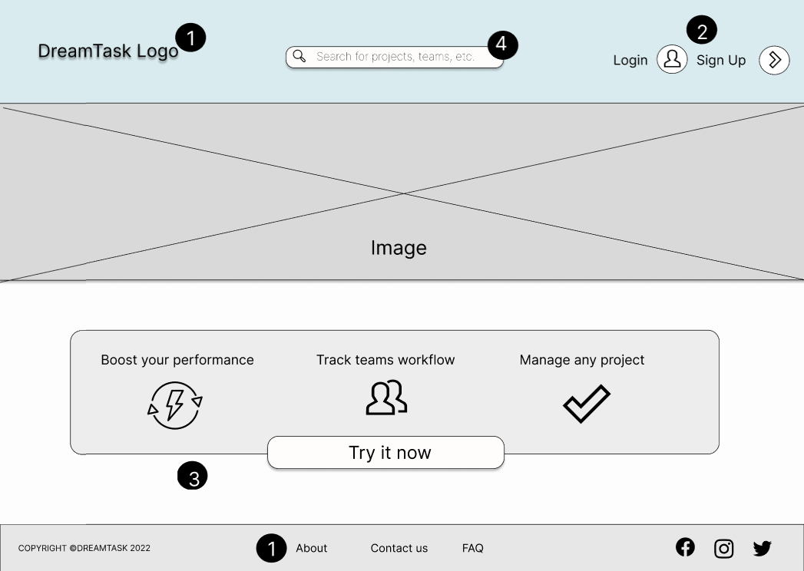
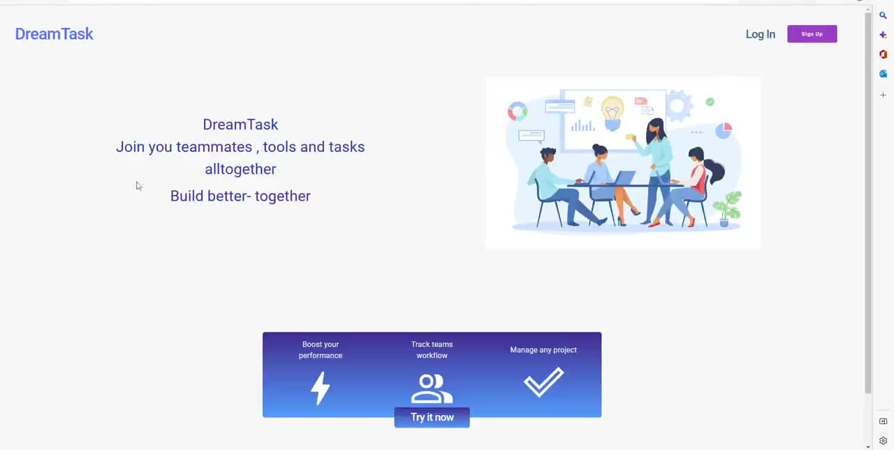
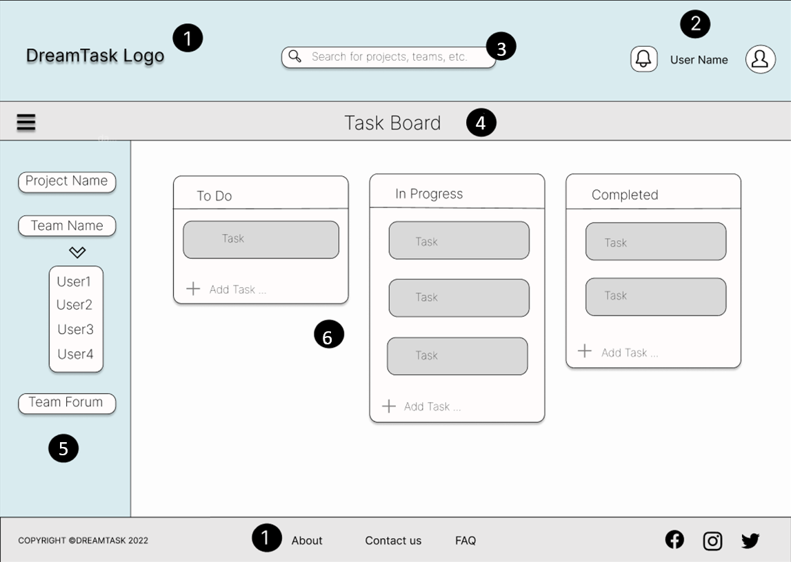
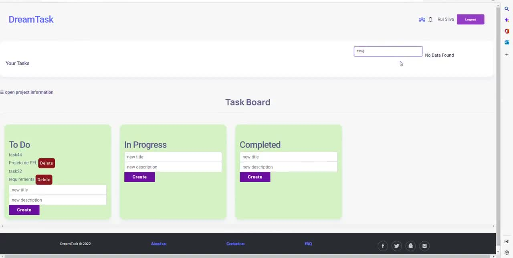
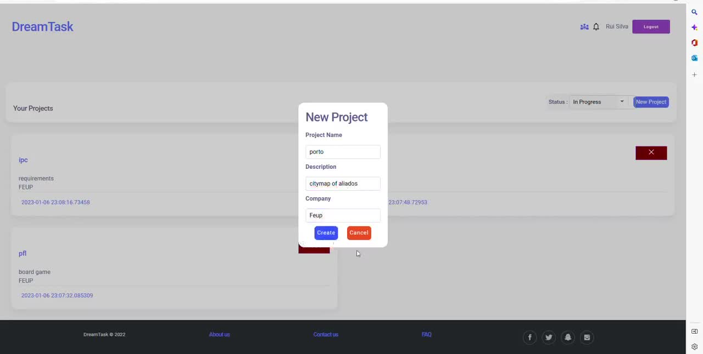
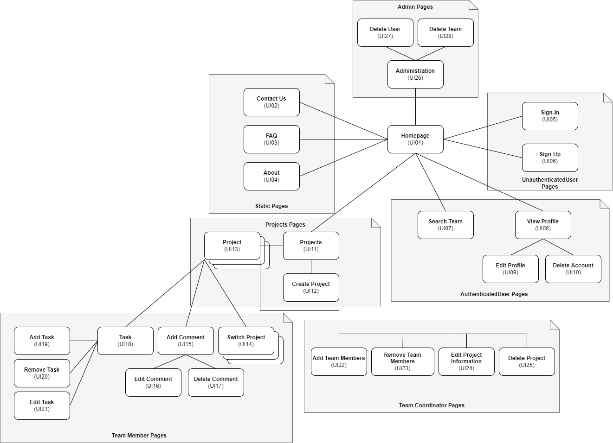
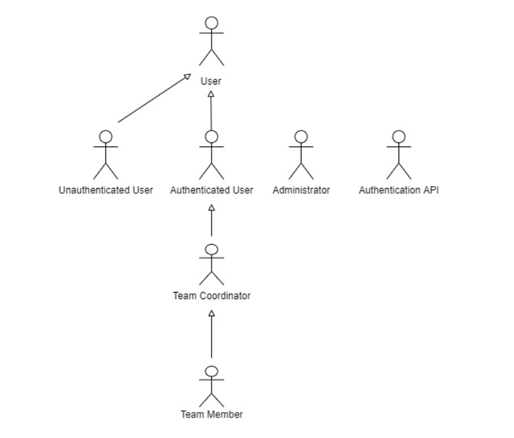
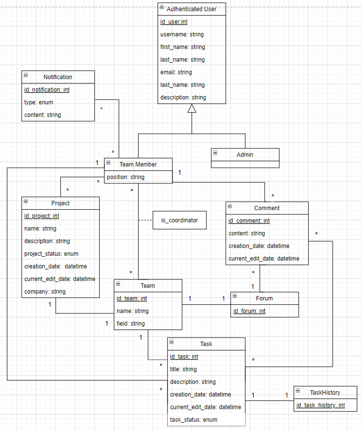

# DreamTask — Project Management Platform

A **Trello-style** web application where teams organise their work in workspaces, projects and task boards.



▶️ **[Watch the full demo (4 min)](docs/dreamtask-demo.mp4)**

## From wireframe to product

| | Wireframe | Final app |
|---|---|---|
| **Landing page** |  |  |
| **Task board** |  |  |

More wireframes: [home](docs/design/wireframe-home.png) · [login and sign-up](docs/design/wireframe-login.png) · Projects page: 

## Features
- Authentication and four user roles with different permissions
- Workspaces, teams, projects and task cards (To Do / In Progress / Completed)
- Live search and notifications
- REST API documented in **OpenAPI**
- Indexes and query tuning for task and project searches

## Design
| Sitemap | Actors | Data model (UML) |
|---|---|---|
|  |  |  |

## Stack
Laravel (PHP) · PostgreSQL · Blade templates · Docker

## Run
```bash
docker compose up
```

---
Academic project developed at FEUP (Faculty of Engineering, University of Porto), Databases and Web Applications Laboratory (LBAW) 2022/23.
