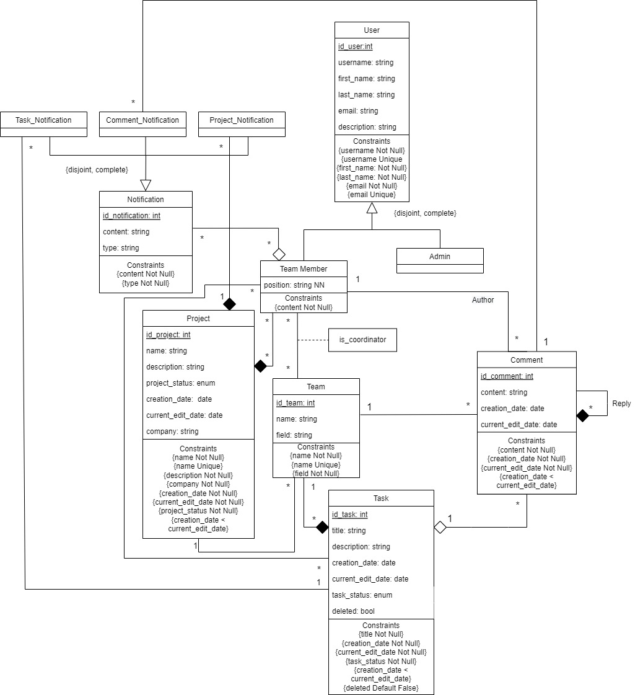

# A4: Conceptual Data Model

## 4.2 Additional Business Rules 

These are some additional rules that can be independent or related to the UML diagram.

BR01. One team can't have more than one coordinator.

BR02. One team has ate least two people.

BR03. There are at least one admnistrator

