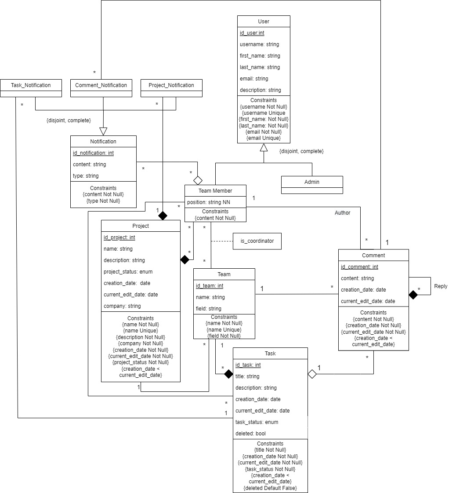

# DreamTask
## ER: Database Specification Component

The purpose of this project is to develop a web application called DreamTask, which is a project management system that will be developed by a small software company, mainly to  define and organize all possible tasks or goals to be achieved individually or as a team.

## A4: Conceptual Data Model

### 1. Class diagram



### 2. Additional Business Rules 

These are some additional rules that can be independent or related to the UML diagram.

BR01. One team can't have less than one coordinator.

BR02. You can't reply to a person that already replied to a comment.

BR03. There is at least one admnistrator.

BR04. To add a comment you need to be performing the same task with the same team.

## A5: Relational Schema, validation and schema refinement

The Relational Schema is used to represent the data to be entered into the database and describe how that data is structured in tables.

### 1. Relational Schema
| Relational Reference | Relation Compact Notation  |
| -------------------- | -------------------------------------------------------------------------------------------------------------------- | 
| R01 | User (<ins>id_user</ins>, username UK NN, first_name NN, last_name NN, email UK NN, description)| 
| R02 | Admin (id_user -> User) |
| R03 | Team_Member (id_user -> User, position NN) | 
| R04 | Project (<ins>id_project</ins>, name UK NN, description NN, project_Status NN, company NN, creation_date NN, current_edit_data NN CK creation_date < current_edit_data ) |
| R05 | Member_Project (<ins>id_project</ins> -> Project, <ins>id_user</ins> -> User, Is_favorite NN DF False) | 
| R06 | Notification (<ins>id_notification</ins>, content NN, type NN) |
| R07 | Member_Notification(<ins>id_user</ins> -> User, <ins>id_notification</ins> -> Notification)| 
| R08 | Team (<ins>id_team</ins>, name UK NN, field NN, id_project -> Project FK)| 
| R09 | Member_Team (<ins>id_user</ins> -> User, <ins>id_team</ins> -> Team, is_coordinator DF False)| 
| R10 | Task (<ins>id_task</ins>, title NN, description NN, creation_date NN, current_edit_date NN CK creation_date < current_edit_data, task_status DF, deleted NN DF False, id_team -> Team FK) |
| R11 | Task_Member (<ins>id_user</ins> -> User, <ins>id_task</ins> -> Task) |
| R12 | Comment (<ins>id_comment</ins>, content NN, creation_date NN, current_edit_date NN CK creation_date < current_edit_data, id_user -> User FK, id_task -> Task FK, id_team -> Team FK ) |

Note: UK means UNIQUE KEY, NN means NOT NULL, DF means DEFAULT, CK means CHECK

### 2. Domains 

| Domain Name | Domain Specification |
| -------------------- | -------------------------------------------------------------------------------------------------------------------- | 
| Notification_type | ENUM('Comment','Task','Project')| 
| Project_Status | ENUM('To do','In Progress','Done') |
| Task_Status | ENUM('To do','In Progress','Done') | 

### 3. Schema Validation

To validate the Relational Schema obtained from the Conceptual Data Model, all functional dependencies are identified and the normalization of all relation schemas is accomplished.

| Table R01 (User)                                  |                                                    |
|----------------------------------------------------|----------------------------------------------------|
| **Keys:** { id_user }, { username }, { email }     |                                                    |
| **Functional Dependencies**                        |                                                    |
| FD0101                                             | { id_user } -> { username, first_name, last_name, email, description } |
| FD0102                                             | { username } -> { id_user, first_name, last_name, email, description } |
| FD0103                                             | { email } -> { id_user, username, first_name, last_name, description } |
| **Normal Form**                                    | BCNF                                               |

| Table R02 (Admin)                                  |                                                    |
|----------------------------------------------------|----------------------------------------------------|
| **Keys:** { id_user }     |                                                    |
| **Functional Dependencies**                        |  none                                                 |
| **Normal Form**                                    | BCNF                                               |

| Table R03 (Team_member)                                  |                                                    |
|----------------------------------------------------|----------------------------------------------------|
| **Keys:** { id_user }      |                                                    |
| **Functional Dependencies**                        |                                                    |
| FD0301                                             | { id_user } -> { position } |
| **Normal Form**                                    | BCNF                                               |

| Table R04 (Project)                                  |                                                    |
|----------------------------------------------------|----------------------------------------------------|
| **Keys:** { id_project }, {name}            |                                                    |
| **Functional Dependencies**                        |                                                    |
| FD0401                                             | { id_project } -> { name, description, project_Status, company, creation_date, current_edit_data} |
| FD0402                                             | { name } -> { id_project, description, project_Status, company, creation_date, current_edit_data} |
| **Normal Form**                                    | BCNF                                               |

| Table R05 (Member_Project)                                  |                                                    |
|----------------------------------------------------|----------------------------------------------------|
| **Keys:** { id_project }, { id_user }    |                                                    |
| **Functional Dependencies**                        |                                                    |
| FD0501                                             | { id_user, id_project } -> { is_favorite } |
| **Normal Form**                                    | BCNF                                               |

| Table R06 (Notification)                                  |                                                    |
|----------------------------------------------------|----------------------------------------------------|
| **Keys:** { id_notification }    |                                                    |
| **Functional Dependencies**                        |                                                    |
| FD0601                                             | { id_notification } -> { content, type } |
| **Normal Form**                                    | BCNF                                               |

| Table R07 (Member_notification)                                  |                                                    |
|----------------------------------------------------|----------------------------------------------------|
| **Keys:** { id_user }, { id_notification }    |                                                    |
| **Functional Dependencies**                        | none                                                   |
| **Normal Form**                                    | BCNF                                               |

| Table R08 (Team)                                  |                                                    |
|----------------------------------------------------|----------------------------------------------------|
| **Keys:** { id_team }, { name }    |                                                    |
| **Functional Dependencies**                        |                                                    |
| FD0801                                             | { id_team } -> { name, field, id_project } |
| FD0802                                             | { name } -> { id_team, field, id_project } |
| **Normal Form**                                    | BCNF                                               |

| Table R09 (Member_Team)                                  |                                                    |
|----------------------------------------------------|----------------------------------------------------|
| **Keys:** { id_user }, { id_team }    |                                                    |
| **Functional Dependencies**                        |                                                    |
| FD0901                                             | { id_user, id_team } -> { is_coordinator } |
| **Normal Form**                                    | BCNF                                               |

| Table R10 (Task)                                  |                                                    |
|----------------------------------------------------|----------------------------------------------------|
| **Keys:** { id_task }   |                                                    |
| **Functional Dependencies**                        |                                                    |
| FD1001                                             | { id_task } -> { title, description, creation_date, current_edit_date, task_status, deleted, id_team} |
| **Normal Form**                                    | BCNF                                               |

| Table R11 (Task_Member)                                  |                                                    |
|----------------------------------------------------|----------------------------------------------------|
| **Keys:** { id_task }, { id_user }    |                                                    |
| **Functional Dependencies**                        | none                                                   |
| **Normal Form**                                    | BCNF                                               |

| Table R12 (Comment)                                  |                                                    |
|----------------------------------------------------|----------------------------------------------------|
| **Keys:** { id_comment }   |                                                    |
| **Functional Dependencies**                        |                                                    |
| FD1201                                             | { id_comment } -> { content, creation_date, current_edit_date, id_user, id_task, id_team } |
| **Normal Form**                                    | BCNF                                               |


Because all relations are in the Boyce–Codd Normal Form (BCNF), the relational schema is also in the BCNF and, therefore, the schema does not need to be further normalised.

## A6: Indexes, triggers, user functions and population

Databases are analyzed for their memory use, maximum loads and I/O operations. This components can give a small approximation of the database performance and its parameters. The workload of a database can be analyzed by determining the number of queries executed by the database in a certain period of time, or the average number of queries being executed at a particular instant of time. This execution time and performance is influenced by the cardinality and the estimated growth rate of the database.


### 1. Database Workload
  
| Relation reference | Relation Name | Order of magnitude        | Estimated growth |
| ------------------ | ------------- | ------------------------- | ---------------- |
| R01                | User          | millions                  | hundreds per day |
| R02                | Admin         | units                     | units per year   |
| R03                | Team_Member   | thousands                 | tens per day     |
| R04                | Project       | thousands                 | hundreds per day |
| R05                | Member_Project| tens of thousands         | hundreds per day |
| R06                | Notification  | hundreds                  | tens per day     |
| R07                | Member_Notification| hundreds             | tens per day     |
| R08                | Team          | thousands                 | hundreds per day |
| R09                | Member_Team   | tens of thousands         | hundreds per day |
| R10                | Task          | hundreds                  | tens per day     |
| R11                | Task_Member   | hundreds                  | tens per day     |
| R12                | Comment       | tens                      | units per day    |


### 2. Proposed Indexes

An index is a schema object and it is used by the server to speed up the retrieval of rows by using a pointer. It can reduce disk I/O(input/output) by using a rapid path access method to locate data quickly. An index helps to speed up select queries and where clauses, but it slows down data input, with the update and the insert statements. Indexes can be created or dropped with no effect on the data and benefit UPDATE and DELETE commands with search conditions.
<br>
Table synchronization is kept by the system after an index is created highlighting data manipulation operations.
The use of indexes requires extra care as they increase the complexity of the database.

#### 2.1 Performance Indexes

In order to improve the speed and performance of selected queries, performance indexes are applied.
At this point, the performance indexes that will have the greatest relevance for the project, as well as the greatest impact in relation to the architecture of our database, are presented.

<br>

| Index  | IDX 01                                                                                                                                                                                       |
|-----------------|---------------------------------------------------------------------------------------------------------------------------------------------------------------------------------------------------|
| Index relation  | Team                                                                                                                                                                                        |
| Index attribute | id_project                                                                                                                                                                                        |
| Index type      | Hash                                                                                                                                                                                              |
| Cardinality     | Medium                                                                                                                                                                                            |
| Clustering      | Yes                                                                                                                                                                                              |
| Justification   | The 'Team' table is accessed frequently so that the user can know which project is associated with that team and what other information belongs to him. The hash type is most suitable in this case as it is exact match filtering. Of the possible indexes, the most relevant will be the one related to the id_project attribute since a project can have multiple teams and it is useful to know the relationship between the two tables often since the user wants to know where it is integrated. In this case, the expected and most likely update frequency is medium, with an average cardinality, so clustering is not taken into account. |
```sql
CREATE INDEX id_project_team ON Team USING btree (id_project);
``` 
<br>

| Index  | IDX 02                                                                                                                                                                                          |
|-----------------|---------------------------------------------------------------------------------------------------------------------------------------------------------------------------------------------------|
| Index relation  | Task                                                                                                                                                                                       |
| Index attribute | creation_date                                                                                                                                                                                     |
| Index type      | B-tree                                                                                                                                                                                              |
| Cardinality     | Medium                                                                                                                                                                                            |
| Clustering      | Yes                                                                                                                                                                                             |
| Justification   | The 'Task' table is accessed very frequently and it is crucial that the user can filter by task dates with the creation_date attribute relative to it. The B-tree type is most suitable in this case allowing for faster date range queries based on the creation date. In this case, the expected and most likely update frequency is average, so no clustering is considered. |
```sql
CREATE INDEX creation_date_task ON Task USING hash (creation_date);
```

<br>

| Index  | IDX 03                                                                                                                                                                                          |
|-----------------|---------------------------------------------------------------------------------------------------------------------------------------------------------------------------------------------------|
| Index relation  | Task                                                                                                                                                                                       |
| Index attribute | task_status                                                                                                                                                                                  |
| Index type      | B-tree                                                                                                                                                                                              |
| Cardinality     | Medium                                                                                                                                                                                            |
| Clustering      | Yes                                                                                                                                                                                             |
| Justification   | The 'Task' table is accessed very frequently and it is crucial that the user can filter by task status with the task_status attribute, to fast info of current task states.The B-tree type is most suitable in this case allowing for faster date range queries based on a status type. In this case, the expected and most likely update frequency is average, so no clustering is considered.|
```sql
CREATE INDEX task_status_task ON Task USING hash (task_status);
``` 

<br>

| Index  | IDX 04                                                                                                                                                                                          |
|-----------------|---------------------------------------------------------------------------------------------------------------------------------------------------------------------------------------------------|
| Index relation  | Comment                                                                                                                                                                                        |
| Index attribute | “id_user”                                                                                                                                                                                         |
| Index type      | Hash                                                                                                                                                                                              |
| Cardinality     | Medium                                                                                                                                                                                            |
| Clustering      | No                                                                                                                                                                                              |
| Justification   | The 'Comment' table is accessed frequently and has to be fast, to allow fast communication and for the user to check whichs comments are associated with him and another users of the application. The hash type is most suitable in this case as it is exact match filtering. Of the possible indexes, one of the related to the comments is the one with the id_user attribute since a user can create or be associated with multiple comments and it is useful to know the relationship between the two tables. In this case, the expected and most likely update frequency is average, so no clustering is taken into account. |
```sql
CREATE INDEX id_user_comment ON Comment USING hash (id_user);
``` 

#### 2.2. Full-text Search Indexes

| Index reference | IDX 05 |
|-----------------|---------------------------|
| Index relation  | Project  |
| Index attribute | name, description, company|
| Index type      | GIN |
| Clustering      | No |
| Justification   | To provide full-text search features to look for projects based on matching name, descriptions or companies. The index type is GIN because the indexed fields are not expected to change often. |
```sql
-- Add column to Project to store computed ts_vectors.
ALTER TABLE Project
ADD COLUMN tsvectors TSVECTOR;

-- Create a function to automatically update ts_vectors.
CREATE FUNCTION project_search_update() RETURNS TRIGGER AS $$
BEGIN
 IF TG_OP = 'INSERT' THEN
        NEW.tsvectors = (
         setweight(to_tsvector('english', NEW.name), 'A') ||
         setweight(to_tsvector('english', NEW.description), 'B') ||
         setweight(to_tsvector('english', NEW.company), 'C')
        );
 END IF;
 IF TG_OP = 'UPDATE' THEN
         IF (NEW.description <> OLD.description OR NEW.company <> OLD.company) THEN
           NEW.tsvectors = (
             setweight(to_tsvector('english', NEW.name), 'A') ||
             setweight(to_tsvector('english', NEW.description), 'B') ||
             setweight(to_tsvector('english', NEW.company), 'C')
           );
         END IF;
 END IF;
 RETURN NEW;
END $$
LANGUAGE plpgsql;

-- Create a trigger before insert or update on Project.
CREATE TRIGGER project_search_update
 BEFORE INSERT OR UPDATE ON Project
 FOR EACH ROW
 EXECUTE PROCEDURE project_search_update();


-- Finally, create a GIN index for ts_vectors.
CREATE INDEX search_idxproj ON Project USING GIN (tsvectors);
```
### 3. Triggers 

A trigger is a special type that automatically runs when an event occurs in the database.


| Trigger       | TRIGGER 01 |
| ------------------ | ------|
| Description   |  This trigger is to check if a user can make a comment.   |
- SQL CODE                   
```sql
CREATE FUNCTION user_comment() RETURNS TRIGGER AS
$BODY$
BEGIN
        IF NOT EXISTS (SELECT * FROM Member_team a INNER JOIN Task_Member b
                        On a.id_user = b.id_user) THEN
            RAISE EXCEPTION 'No permissions to make a comment';
        END IF
        RETURN NEW;
END
$BODY$
LANGUAGE plpgsql;

CREATE TRIGGER user_comment
        BEFORE Insert ON Comment
        FOR EACH ROW
        EXECUTE PROCEDURE user_comment();
```


| Trigger       | TRIGGER 02 |
| ------------------ | ------|
| Description   | This trigger serves to check if the username entered by the user is valid.    |
- SQL CODE                   
```sql
CREATE FUNCTION verify_username() RETURNS TRIGGER AS
$BODY$
BEGIN
        IF EXISTS (SELECT * FROM "User" WHERE NEW.username = username ) THEN
            RAISE EXCEPTION 'Username Invalid';
        END IF
        RETURN NEW;
END
$BODY$
LANGUAGE plpgsql;

CREATE TRIGGER verify_username
        BEFORE INSERT OR UPDATE ON "User"
        FOR EACH ROW
        EXECUTE PROCEDURE verify_username();
```
| Trigger       | TRIGGER 03 |
| ------------------ | ------|
| Description   | This trigger serves to check if the email entered by the user is valid.    |
- SQL CODE                   
```sql
CREATE FUNCTIONverify_email() RETURNS TRIGGER AS
$BODY$
BEGIN
        IF EXISTS (SELECT * FROM "User" WHERE NEW.email = email ) THEN
            RAISE EXCEPTION 'Email Invalid';
        END IF
        RETURN NEW;
END
$BODY$
LANGUAGE plpgsql;

CREATE TRIGGER verify_email
        BEFORE INSERT OR UPDATE ON "User"
        FOR EACH ROW
        EXECUTE PROCEDURE verify_email();
```
| Trigger       | TRIGGER 04 |
| ------------------ | ------|
| Description   | Check if there is at least one coordinator in a team   |
- SQL CODE                   
```sql
CREATE FUNCTION exits_coordenator() RETURNS TRIGGER AS
$BODY$
BEGIN
        IF NOT EXISTS (SELECT * FROM Member_Team WHERE iscoordenator ) THEN
            RAISE EXCEPTION 'A coordinator is missing from your team';
        END IF
        RETURN NEW;
END
$BODY$
LANGUAGE plpgsql;

CREATE TRIGGER exits_coordenator
        BEFORE INSERT OR UPDATE ON Team
        FOR EACH ROW
        EXECUTE PROCEDURE exits_coordenator();
```


### 4. Transactions

| Transaction   | TR01                                                                                                                                                                                        |
|-----------------|---------------------------------------------------------------------------------------------------------------------------------------------------------------------------------------------------|
|  Description | Receiving a notification about a new task                                                                                                                                                                                  |
| Justification | This transaction maintains consistency because it handles errors by sending a ROLLBACK whenever the insertion of a new task fails. We use REPEATABLE READ once we should only access the data previously commited in order to avoid conflicting entries in the database.                                                                                                                                                                                          |
| Isolation level      | REPEATABLE READ                                                                                                                                                                                             |
| SQL Code     |                                                                                                                                                                                             |

```sql
BEGIN TRANSACTION;

SET TRANSACTION ISOLATION LEVEL REPEATABLE READ

-- Insert notification
INSERT INTO notification (id_team, content,notification_type ,id_task, id_comment,id_project)
 VALUES ($id_notification, $id_team, $content, $notification_type , $id_task, $id_comment,$id_project);

-- Insert task
INSERT INTO task (title, description,creation_date, current_edit_date, task_status, deleted, id_team)
 VALUES (currval('notification_id_seq'), $title, $description, $creation_date, $current_edit_date, $task_status, $deleted, $id_team );

END TRANSACTION;
```


| Transaction   | TR02                                                                                                                                                                                       |
|-----------------|---------------------------------------------------------------------------------------------------------------------------------------------------------------------------------------------------|
|  Description | Receiving a notification about a new comment                                                                                                                                                                                  |
| Justification | This transaction maintains consistency because it handles errors by sending a ROLLBACK whenever the insertion of a new task fails. We use REPEATABLE READ once we should only access the data previously commited in order to avoid conflicting entries in the database.                                                                                                                                                                                          |
| Isolation level      | REPEATABLE READ                                                                                                                                                                                             |
| SQL Code     |                                                                                                                                                                                             |

```sql
BEGIN TRANSACTION;

SET TRANSACTION ISOLATION LEVEL REPEATABLE READ

-- Insert notification
INSERT INTO notification (id_team, content,notification_type ,id_task, id_comment,id_project)
 VALUES ($id_notification, $id_team, $content, $notification_type , $id_task, $id_comment,$id_project);

-- Insert task
INSERT INTO comment (content,creation_date, current_edit_date, id_team, id_task, id_user, comment)
 VALUES (currval('notification_id_seq'),$content,$creation_date, $current_edit_date, $id_team, $id_task, $id_user, $comment);

END TRANSACTION;
```


| Transaction   | TR03                                                                                                                                                                                       |
|-----------------|---------------------------------------------------------------------------------------------------------------------------------------------------------------------------------------------------|
|  Description | Receiving a notification about a new project                                                                                                                                                                                  |
| Justification | This transaction maintains consistency because it handles errors by sending a ROLLBACK whenever the insertion of a new task fails. We use REPEATABLE READ once we should only access the data previously commited in order to avoid conflicting entries in the database.                                                                                                                                                                                          |
| Isolation level      | REPEATABLE READ                                                                                                                                                                                             |
| SQL Code     |                                                                                                                                                                                             |

```sql
BEGIN TRANSACTION;

SET TRANSACTION ISOLATION LEVEL REPEATABLE READ

-- Insert notification
INSERT INTO notification (id_team, content,notification_type ,id_task, id_comment,id_project)
 VALUES ($id_notification, $id_team, $content, $notification_type , $id_task, $id_comment,$id_project);

-- Insert task
INSERT INTO projet (name, description,creation_date, current_edit_date, project_status, company)
 VALUES (currval('notification_id_seq'), $name, $description, $creation_date, $current_edit_date, $project_status, $company );

END TRANSACTION;
```

## Annex A. SQL Code

### A.1. Database schema
```sql
--Drop tables
DROP TABLE IF EXISTS Member_Project;
DROP TABLE IF EXISTS Member_Notification;
DROP TABLE IF EXISTS Notification;
DROP TABLE IF EXISTS Comment;
DROP TABLE IF EXISTS Task_Member;
DROP TABLE IF EXISTS Task;
DROP TABLE IF EXISTS Member_Team;
DROP TABLE IF EXISTS Team;
DROP TABLE IF EXISTS Project;
DROP TABLE IF EXISTS Team_member;
DROP TABLE IF EXISTS Admin;
DROP TABLE IF EXISTS "User";

--Drop Types

DROP TYPE IF EXISTS Notification_Type CASCADE;
DROP TYPE IF EXISTS Status CASCADE;

--TYPES

CREATE TYPE Notification_Type AS ENUM ('Comment','Task','Project');
CREATE TYPE Status AS ENUM ('To Do','In Progress','Done');

--Tables

CREATE TABLE "User" (
   id_user SERIAL,
   username varchar(255) NOT NULL UNIQUE,
   first_name varchar(255) NOT NULL,
   last_name varchar(255) NOT NULL,
   email varchar(255) NOT NULL UNIQUE,
   description TEXT,
   CONSTRAINT id_userPK PRIMARY KEY(id_user)
);

CREATE TABLE Admin (
    id_admin INTEGER REFERENCES "User" (id_user) ON DELETE CASCADE ON UPDATE CASCADE,
    CONSTRAINT id_adminPK PRIMARY KEY(id_admin)
);

CREATE TABLE Team_Member (
    id_user INTEGER REFERENCES "User" (id_user) ON UPDATE CASCADE,
    position varchar(255) NOT NULL,
    CONSTRAINT team_memberPK PRIMARY KEY(id_user)
);

CREATE TABLE Project (
    id_project SERIAL,
    name varchar(255) NOT NULL UNIQUE,
    description TEXT NOT NULL,
    project_status Status DEFAULT 'To Do',
    company TEXT NOT NULL,
    creation_date TIMESTAMP NOT NULL DEFAULT CURRENT_TIMESTAMP,
    current_edit_date TIMESTAMP NOT NULL DEFAULT CURRENT_TIMESTAMP,
	CONSTRAINT id_projectPK PRIMARY KEY(id_project),
    CONSTRAINT current_edit_date_ck CHECK (creation_date <= current_edit_date)
);
CREATE TABLE Member_Project (
    id_project INTEGER,
    id_user INTEGER,
    CONSTRAINT member_projectPK PRIMARY KEY(id_project, id_user),
    CONSTRAINT id_projectFK FOREIGN KEY(id_project) REFERENCES Project ON DELETE CASCADE ON UPDATE CASCADE,
    CONSTRAINT id_userFK FOREIGN KEY(id_user) REFERENCES "User" ON DELETE CASCADE ON UPDATE CASCADE
);


CREATE TABLE Team (
    id_team SERIAL,
    name varchar(255) NOT NULL UNIQUE,
    field varchar(255) NOT NULL,
    id_project INTEGER REFERENCES Project (id_project) ON UPDATE CASCADE,
    CONSTRAINT id_teamPK PRIMARY KEY(id_team),
    CONSTRAINT id_projectFK FOREIGN KEY(id_project) REFERENCES Project ON DELETE CASCADE ON UPDATE CASCADE
);

CREATE TABLE Member_Team (
    id_user INTEGER,
    id_team INTEGER,
    is_coordinator BOOLEAN NOT NULL DEFAULT False,
    CONSTRAINT member_teamPK PRIMARY KEY(id_user, id_team),
    CONSTRAINT id_userFK FOREIGN KEY(id_user) REFERENCES "User" ON DELETE CASCADE ON UPDATE CASCADE,
    CONSTRAINT id_teamFK FOREIGN KEY(id_team) REFERENCES Team ON DELETE CASCADE ON UPDATE CASCADE
);


CREATE TABLE Task (
    id_Task SERIAL,
    title varchar(255) NOT NULL,
    description TEXT NOT NULL,
    creation_date TIMESTAMP NOT NULL DEFAULT CURRENT_TIMESTAMP,
    current_edit_date TIMESTAMP NOT NULL DEFAULT CURRENT_TIMESTAMP,
    task_status Status NOT NULL DEFAULT 'To Do',
    deleted BOOLEAN NOT NULL DEFAULT False,
    id_team INTEGER,
    CONSTRAINT id_taskPK PRIMARY KEY(id_task),
	CONSTRAINT id_teamFK FOREIGN KEY(id_team) REFERENCES Team ON DELETE CASCADE ON UPDATE CASCADE,
    CONSTRAINT current_edit_date_ck CHECK (creation_date <= current_edit_date)
);


CREATE TABLE Task_Member (
    id_user INTEGER,
    id_task INTEGER,
    CONSTRAINT task_memeberPK PRIMARY KEY(id_user, id_task),
    CONSTRAINT id_userFK FOREIGN KEY(id_user) REFERENCES "User" ON DELETE CASCADE ON UPDATE CASCADE,
    CONSTRAINT id_taskFK FOREIGN KEY(id_task) REFERENCES Task ON DELETE CASCADE ON UPDATE CASCADE
);

CREATE TABLE Comment (
    id_comment SERIAL,
    content TEXT NOT NULL,
    creation_date TIMESTAMP NOT NULL DEFAULT CURRENT_TIMESTAMP,
    current_edit_date TIMESTAMP NOT NULL DEFAULT CURRENT_TIMESTAMP,
    id_user INTEGER,
    id_task INTEGER,
    id_team INTEGER,
	comment INTEGER,
	CONSTRAINT id_commentPK PRIMARY KEY(id_comment),
    CONSTRAINT id_userFK FOREIGN KEY(id_user) REFERENCES "User" ON DELETE CASCADE ON UPDATE CASCADE,
    CONSTRAINT id_taskFK FOREIGN KEY(id_task) REFERENCES Task ON DELETE CASCADE ON UPDATE CASCADE,
    CONSTRAINT id_teamFK FOREIGN KEY(id_team) REFERENCES Team ON DELETE CASCADE ON UPDATE CASCADE,
	CONSTRAINT id_commentFK FOREIGN KEY(id_comment) REFERENCES Comment ON DELETE CASCADE ON UPDATE CASCADE,
    CONSTRAINT current_edit_date_ck CHECK (creation_date <= current_edit_date)
);


CREATE TABLE Notification (
    id_notification SERIAL,
    content TEXT NOT NULL,
    type Notification_type NOT NULL,
    id_task INTEGER,
    id_comment INTEGER,
    id_project INTEGER,
    CONSTRAINT id_notificationPK PRIMARY KEY(id_notification),
    CONSTRAINT id_taskFK FOREIGN KEY(id_task) REFERENCES Task ON DELETE CASCADE ON UPDATE CASCADE,
    CONSTRAINT id_commentFK FOREIGN KEY(id_comment) REFERENCES Comment ON DELETE CASCADE ON UPDATE CASCADE,
    CONSTRAINT id_teamFK FOREIGN KEY(id_project) REFERENCES Project ON DELETE CASCADE ON UPDATE CASCADE
    
);

CREATE TABLE Member_Notification (
    id_user INTEGER,
    id_notification INTEGER,
	is_favorite BOOLEAN NOT NULL DEFAULT False,
    CONSTRAINT member_notificationPK PRIMARY KEY(id_user, id_notification),
    CONSTRAINT id_userFK FOREIGN KEY(id_user) REFERENCES "User" ON DELETE CASCADE ON UPDATE CASCADE,
    CONSTRAINT id_notificationFK FOREIGN KEY(id_notification) REFERENCES Notification ON DELETE CASCADE ON UPDATE CASCADE
);
```

### A.2. Database population
```sql
/*User*/
INSERT INTO "User" (username, first_name, last_name, email, description) VALUES ('USER1', 'Rui', 'Silva', 'ruisilva@gmail.com', 'sou user1 e admin');
INSERT INTO "User" (username, first_name, last_name, email, description) VALUES ('USER2', 'Armando', 'Pires', 'armandopires@gmail.com', 'sou user2');
INSERT INTO "User" (username, first_name, last_name, email, description) VALUES ('USER3', 'Ana', 'Borges', 'anaborges@gmail.com', 'sou user3');
INSERT INTO "User" (username, first_name, last_name, email, description) VALUES ('USER4', 'Joao', 'Pereira', 'joaopereira@gmail.com', 'sou user4');
INSERT INTO "User" (username, first_name, last_name, email, description) VALUES ('USER5', 'Joana', 'Silva', 'joanasilva@gmail.com', 'sou user5');
INSERT INTO "User" (username, first_name, last_name, email, description) VALUES ('USER6', 'Miguel', 'Oliveira', 'migueloliveira@gmail.com', 'sou user6 e admin');
INSERT INTO "User" (username, first_name, last_name, email, description) VALUES ('USER7', 'Pedro', 'Sousa', 'pedrosousa@gmail.com', 'sou user7');

/*Admin*/
INSERT INTO Admin (id_admin) VALUES (1);
INSERT INTO Admin (id_admin) VALUES (6);

/*Team_Member*/
INSERT INTO Team_Member (id_user, position) VALUES (2, 'Software developer');
INSERT INTO Team_Member (id_user, position) VALUES (3, 'Team lead');
INSERT INTO Team_Member (id_user, position) VALUES (4, 'Tester');
INSERT INTO Team_Member (id_user, position) VALUES (5, 'Software architect');
INSERT INTO Team_Member (id_user, position) VALUES (7, 'Product Manager');

/*Project*/
INSERT INTO Project (name, description, company) VALUES ('Proj1', 'este é o project 1', 'company X');
INSERT INTO Project (name, description, company) VALUES ('Proj2', 'este é o project 2', 'company X');
INSERT INTO Project (name, description, company) VALUES ('Proj3', 'este é o project 3', 'company Y');
INSERT INTO Project (name, description, company) VALUES ('Proj4', 'este é o project 4', 'company Z');
INSERT INTO Project (name, description, company) VALUES ('Proj5', 'este é o project 5', 'company Y');

/*Member_Project*/
INSERT INTO Member_Project (id_project, id_user) VALUES (1,4);
INSERT INTO Member_Project (id_project, id_user) VALUES (1,2);
INSERT INTO Member_Project (id_project, id_user) VALUES (1,3);
INSERT INTO Member_Project (id_project, id_user) VALUES (2,7);
INSERT INTO Member_Project (id_project, id_user) VALUES (3,4);
INSERT INTO Member_Project (id_project, id_user) VALUES (3,5);
INSERT INTO Member_Project (id_project, id_user) VALUES (3,3);
INSERT INTO Member_Project (id_project, id_user) VALUES (3,2);
INSERT INTO Member_Project (id_project, id_user) VALUES (4,5);
INSERT INTO Member_Project (id_project, id_user) VALUES (4,2);

/*Team*/
INSERT INTO Team (name, field, id_project) VALUES ('team1', 'field da team 1', 1);
INSERT INTO Team (name, field, id_project) VALUES ('team2', 'field da team 2', 1);
INSERT INTO Team (name, field, id_project) VALUES ('team3', 'field da team 3', 2);
INSERT INTO Team (name, field, id_project) VALUES ('team4', 'field da team 4', 3);
INSERT INTO Team (name, field, id_project) VALUES ('team5', 'field da team 5', 3);
INSERT INTO Team (name, field, id_project) VALUES ('team6', 'field da team 6', 4);

/*Member_Team*/
INSERT INTO Member_Team (id_user, id_team, is_coordinator) VALUES (2, 1, True);
INSERT INTO Member_Team (id_user, id_team, is_coordinator) VALUES (3, 2, True);
INSERT INTO Member_Team (id_user, id_team, is_coordinator) VALUES (4, 2, False);
INSERT INTO Member_Team (id_user, id_team, is_coordinator) VALUES (7, 3, True);
INSERT INTO Member_Team (id_user, id_team, is_coordinator) VALUES (2, 4, True);
INSERT INTO Member_Team (id_user, id_team, is_coordinator) VALUES (4, 4, False);
INSERT INTO Member_Team (id_user, id_team, is_coordinator) VALUES (5, 5, False);
INSERT INTO Member_Team (id_user, id_team, is_coordinator) VALUES (3, 5, True);
INSERT INTO Member_Team (id_user, id_team, is_coordinator) VALUES (5, 6, False);
INSERT INTO Member_Team (id_user, id_team, is_coordinator) VALUES (2, 6, True);

/*Task*/
INSERT INTO Task (title, description, id_team) VALUES ('task1', 'esta é a task 1', 1);
INSERT INTO Task (title, description, id_team) VALUES ('task2', 'esta é a task 2', 1);
INSERT INTO Task (title, description, id_team) VALUES ('task3', 'esta é a task 3', 2);
INSERT INTO Task (title, description, id_team) VALUES ('task4', 'esta é a task 4', 3);
INSERT INTO Task (title, description, id_team) VALUES ('task5', 'esta é a task 5', 4);
INSERT INTO Task (title, description, id_team) VALUES ('task6', 'esta é a task 6', 4);
INSERT INTO Task (title, description, id_team) VALUES ('task7', 'esta é a task 7', 4);
INSERT INTO Task (title, description, id_team) VALUES ('task8', 'esta é a task 8', 5);
INSERT INTO Task (title, description, id_team) VALUES ('task9', 'esta é a task 9', 5);
INSERT INTO Task (title, description, id_team) VALUES ('task10', 'esta é a task 10', 6);

/*Task_Member*/
INSERT INTO Task_Member (id_user, id_task) VALUES (2, 1);
INSERT INTO Task_Member (id_user, id_task) VALUES (2, 2);
INSERT INTO Task_Member (id_user, id_task) VALUES (3, 3);
INSERT INTO Task_Member (id_user, id_task) VALUES (4, 3);
INSERT INTO Task_Member (id_user, id_task) VALUES (7, 4);
INSERT INTO Task_Member (id_user, id_task) VALUES (2, 5);
INSERT INTO Task_Member (id_user, id_task) VALUES (4, 5);
INSERT INTO Task_Member (id_user, id_task) VALUES (2, 6);
INSERT INTO Task_Member (id_user, id_task) VALUES (4, 6);
INSERT INTO Task_Member (id_user, id_task) VALUES (4, 7);
INSERT INTO Task_Member (id_user, id_task) VALUES (5, 8);
INSERT INTO Task_Member (id_user, id_task) VALUES (3, 8);
INSERT INTO Task_Member (id_user, id_task) VALUES (3, 9);
INSERT INTO Task_Member (id_user, id_task) VALUES (5, 10);
INSERT INTO Task_Member (id_user, id_task) VALUES (2, 10);

/*Comment*/
INSERT INTO Comment (content, id_user, id_task, id_team) VALUES ('comentario 1', 2, 1, 1);
INSERT INTO Comment (content, id_user, id_task, id_team) VALUES ('comentario 2', 2, 1, 1);
INSERT INTO Comment (content, id_user, id_task, id_team) VALUES ('comentario 3', 4, 3, 2);
INSERT INTO Comment (content, id_user, id_task, id_team) VALUES ('comentario 4', 3, 3, 2);
INSERT INTO Comment (content, id_user, id_task, id_team) VALUES ('comentario 5', 3, 8, 5);

/*Notification*/
INSERT INTO Notification (content, type, id_task) VALUES ('notification 1', 'Task', 1);
INSERT INTO Notification (content, type, id_comment) VALUES ('notification 2', 'Comment', 3);
INSERT INTO Notification (content, type, id_project) VALUES ('notification 3', 'Project', 3);
INSERT INTO Notification (content, type, id_task) VALUES ('notification 4', 'Task', 8);
INSERT INTO Notification (content, type, id_project) VALUES ('notification 5', 'Project', 1);


/*Member_Notification*/
INSERT INTO Member_Notification (id_user, id_notification) VALUES (2, 1);
INSERT INTO Member_Notification (id_user, id_notification) VALUES (4, 2);
INSERT INTO Member_Notification (id_user, id_notification) VALUES (3, 2);
INSERT INTO Member_Notification (id_user, id_notification) VALUES (4, 3);
INSERT INTO Member_Notification (id_user, id_notification) VALUES (5, 3);
INSERT INTO Member_Notification (id_user, id_notification) VALUES (3, 3);
INSERT INTO Member_Notification (id_user, id_notification) VALUES (2, 3);
INSERT INTO Member_Notification (id_user, id_notification) VALUES (5, 4);
INSERT INTO Member_Notification (id_user, id_notification) VALUES (3, 4);
INSERT INTO Member_Notification (id_user, id_notification) VALUES (4, 5);
INSERT INTO Member_Notification (id_user, id_notification) VALUES (2, 5);
INSERT INTO Member_Notification (id_user, id_notification) VALUES (3, 5);
```

## Revision history

Changes made to the first submission:

1.
2.

<br>

## Team

* Alberto Serra up202103627, up202103627@g.uporto.pt
* Luísa Salvador up202006471, up202006471@g.uporto.pt
* Luís Paiva up202006094, up202006094@g.uporto.pt
* Rafael Alves up202004476, up202004476@g.uporto.pt

***
G02T04, 2022/2023