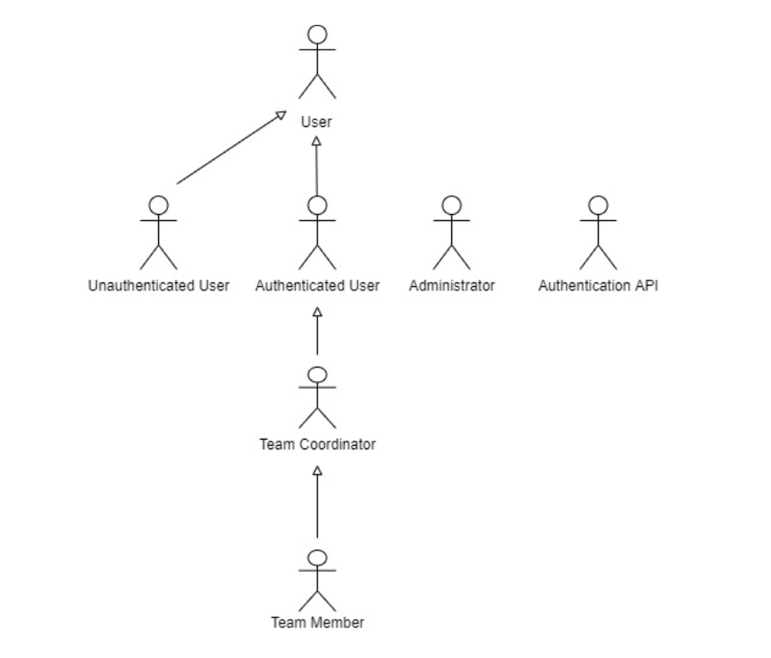

# A2: Actors and User stories

This artifact contains the specification of the actors and their user stories, serving as agile documentation of the project’s requirements.

## 1. Actors

An Actor specifies a role played by a user or any other system that interacts with the subject. For the DreamTask the actors are represented in Figure 1 and described in Table 1.

Figure 1: Actors

| Identifier           | Description                                                                                                                                                  | Examples                    |
| -------------------- | ------------------------------------------------------------------------------------------------------------------------------------------------------------ | --------------------------- |
| User                 | Generic User. Access to public information and can perform action as search and view pages.                                                | n/a                         |
| Unauthenticated User | Can register or authenticate in the system.                                                                                     | n/a                         |
| Authenticated User   | Can manage their personal information and do some actions in the system.                                                              | john123                     |
| Administrator        | Responsible for the management, supervisory and moderation functions. Such as blocking users. | admin                       | 
| Team member       | Authenticated user; Project member allowed to complete, assign tasks and comment in team forum. | john123
| Team Coordinator       | Authenticated user responsible for projects; Allowed to add members to a project, create and distribute tasks to team members and moderate the team forum. | Boss1                       |
| Authentication API                  | External APIs that can be used to register and authenticate users into the system.                                                                                  | Google Sign In for Websites |

Table 1:  DreamTask actors descriptions

 
 

## 2. User Stories

A user story is a short, simple description of a feature told from the perspective of the person who desires the new capability, usually a user or customer of the system.
 
On the tables below are the user stories that define the functions of our application.

**User**

| Identifier | Name                                                | Priority | Description                                                                                                                          |
|------------|-----------------------------------------------------|----------|--------------------------------------------------------------------------------------------------------------------------------------|
| US01       | Homepage                                            | high     | As a User, I want to access the home page, so that I can see the website display and main layout.                                       |
| US02       | About page                                | high     | As a User, I want to access the about page, to read a complete description of the website, learn about the history of the creators and find curiosities about the platform.                                 |
| US03       | FAQ page                                | high     | As a User, I want to access the FAQ page so I can find solutions to my doubts in the form of objective questions to other users.                                                 |
| US04       | Contacts page                          | high     | As a User, I want to be able to contact the platform creators for any kind of pertinent question or seek help.

Table 2: Users user stories

 

**Unauthenticated User**

| Identifier | Name                       | Priority | Description                                                                                                                                         |
| ---------- | -------------------------- | -------- | --------------------------------------------------------------------------------------------------------------------------------------------------- |
| US05       | Sign-In                    | high     | As an Unauthenticated User, I want to authenticate into the system, so that I can access my information.                                    |
| US06       | Sign-Up                    | high     | As an Unauthenticated User, I want to register into the system, so that I can authenticate myself into the system.                           |
| US07       | Sign-In using external API | low      | As an Unauthenticated User, I want to authenticate into the system using an external account, so that I can access my information.          |
| US08       | Sign-Up using external API | low      | As an Unauthenticated User, I want to register into the system using an external account, so that I can authenticate myself into the system. |

Table 3: Unauthenticated users user stories

 

**Authenticated User**

| Identifier | Name                                   | Priority | Description                                                                                                                                                 |
|------------|----------------------------------------|----------|-------------------------------------------------------------------------------------------------------------------------------------------------------------|
| US09       | View profile                              | high     | As an Authenticated User, I want to see my profile information, so that I can keep track of my info.                                                       |
| US10       | Edit profile                       | medium     | As an Authenticated User, I want to edit my profile, so that I can update my data.                                                               |
| US11       | Delete account                  | high     | As an Authenticated User, I want to delete my account, so that I can erase all my info from the website.                                                                  |
| US12      | Create Project                         | high     | As an Authenticated User, I want to Create a Project, so that I can start my own project. |
| US13       | Search Team                          | high     | As an Authenticated User, I want to search for a team, so that I can find the team faster.                                                |
| US14       | Sign Out                           | high     | As an Authenticated User, I want to sign out, so that I can leave the app safely.

Table 4: Authenticated users user stories

 

**Administrator**

| Identifier | Name                  | Priority | Description                                                                                                           |
|------------|-----------------------|----------|-----------------------------------------------------------------------------------------------------------------------|
| US15      | Delete user              | high     | As an Admin, I want to be able to delete a user so that I can keep control of who is using the platform.                                |
| US16       | Delete Team          | high     | As an Admin,  I want to be able to delete a team so that I can keep control of what teams are using the platform.                           |
| US17       | Block and Unblock User Accounts       | high    | As an Admin, I want to block and unblock user accounts so that I can control what certain users can do.         |
| US18       | Edit accounts       | high    | As an Admin, I want to edit accounts so that I can change things about certain user profiles.         |
| US19       | Add FAQ         | low     | As an Admin, I want to add the most common questions so the users don’t need to ask me the same things.        
| US20       | Edit FAQ       | low     | As an Admin, I want to edit comments, so the I can manage the users comments and my own too.         |                         |
| US21       | Remove FAQ       | low     | As an Admin, I want to remove the most common questions so the users don’t need to ask me the same things.         |

Table 5: Administrator's user stories

 

**Team Member**

| Identifier | Name                  | Priority | Description                                                                                                           |
|------------|-----------------------|----------|-----------------------------------------------------------------------------------------------------------------------|
| US22      | Switch Project              | high     | As a Team Member, I want to change projects, so that I can always be satisfied and motivated with my work and still be inside the same workspace.                                |
| US23       | Switch Team          | high     | As a Team Member, I want to switch teams, so that  I can help a team that is having difficulties finishing their part of the project.                           |
| US24       | View Projects         | high     | As a Team Member, I want to access the home page, so that I can see my projects.                                 |
| US25       | View Task       | high     | As an Authenticated User, I want to see my task, so that I can see more information about it like the description or the assignees.         |
| US26       | View TaskList         | high     | As a Team Member, I want to see my task list, so that I can see the amount of work I have to accomplish.                                 |
| US27       | Add Task        | high     | As a Team Member, I want to add a task, so that I can have the new task registered.                                 |
| US28       | Remove Task       | high     | As a Team Member, I want to remove a task so that whenever I can’t find its purpose on the project, it doesn’t affect the workflow.                                 |
| US29       | Search Task        | high     | As a Team Member, I want to search for a task, so that I can find the task faster.                                 |
| US30       | Add comment        | high     | As a Team Member, I want to comment in the team  forum, so that I can inform others about proposals, errors or issues.                                 |
| US31       | Edit comment       | high     | As a Team Member, I want to edit a comment in the team forum, so that I can make clearer what I want to say.                                 |
| US32       | Delete my comment        | high     | As a Team Member, I want to eliminate a comment, so that I can have only constructive comments on the team forum.                                 |
| US33       | View history of previous tasks        | high     | As a Team Member, I want to view the history of previous tasks, so that I can recover lost tasks.                                 |
| US34       | Mark as Completed       | low     | As a Team Member, I want to mark the tasks as completed, so that I can keep track of the work done.                               |
| US35       | Mark as Uncompleted        | low     | As a Team Member, I want to mark the tasks as completed, so that I can keep track of the unfinished work.                                |
| US36       | Reply Comments        | low     | As a Team Member,  I want to reply to comments, so that I can interact with a comment.                                |

Table 6: Team Member's user stories

 

**Team Coordinator**

| Identifier | Name                  | Priority | Description                                                                                                           |
|------------|-----------------------|----------|-----------------------------------------------------------------------------------------------------------------------|
| US37      | Distribute Tasks to Team Members              | high     | As a Team Coordinator, I want to distribute tasks to Team Members, so that I distribute tasks equally.                                |
| US38       | Add Team Members          | high     | As a Team Coordinator, I want to add Team Members, so that I can have a bigger team.                           |
| US39       | Remove Team Members         | high     | As a Team Coordinator, I want to remove Team Members, so that I can keep my Team Members updated.                                 |
| US40       | Edit Project Information       | high     | As a Team Coordinator, I want to Edit Project Information, so that I can change information about the project that needed to be improved. |
| US41       | Remove Project         | high     | As a Team Coordinator, I want to Remove a Project, so that I can delete a project that is no longer needed.                           |

Table 7: Team Coordinator's user stories

 

## 3. Supplementary requirements

The following section will present the chosen business rules, technical requirements and non-functional requirements on the project.

**Business rules**

A business rule defines the aspects and constraints of the business, with the purpose of implementing a certain business structure and influencing business actions. 

| Identifier           | Name                                                                                                                                                  | Description                    |
| -------------------- | ------------------------------------------------------------------------------------------------------------------------------------------------------------ | --------------------------- |
| BS01                | Task deadline                                               | The tasks need to be completed within their respective deadline.                       |
| BS02                | Task limit                                               | The team member cannot add more than ten tasks in a work day.                       |
| BS03                |   Deleted Team Member Information                                          | The deleted team member  information has his data stored on the database but it is not visible to other users.                     |

Table 8: Supplementary requirement´s Business Rules

**Technical requirements**

This part concerns technical aspects that will be used in the respective system, such as performance-related issues, reliability issues and availability issues.

| Identifier           | Name                                                                                                                                                  | Description                    |
| -------------------- | ------------------------------------------------------------------------------------------------------------------------------------------------------------ | --------------------------- |
| TR01                | App availability                                               | The system must be available 99 percent of the time.                       |
| TR02                | App accessibility                                               | The system must provide the access of the pages to everyone ,independently of any condition, like being handicap, or the web browser they use.                       |
| TR03                | Robustness                                              | The app needs to continue execution, even when runtime errors occur.                       |
| TR04                | Scalability                                               | The app system has to be prepared to handle a big number of new users and their traffic.                       |
| TR05                | Software ethics                                              | Hidden user details or personal data, should not be shared without full acknowledgement and authorization from its owner.                       |
| TR06                | Software security                                               | The app needs to be prepared to protect information from external inputs or attacks that will try to corrupt the system data.                       |
| TR07                | Data management                                              | The database PostgreSQL database management system must be used, with a version of 11 or higher.                       |
| TR08                | App portability                                               | This system should be platform independent, making it available to the maximum number of users possible.                       |

Table 9: Supplementary requirement´s Technical requirements

**Restrictions**

A restriction on the design puts barriers for the user

| Identifier           | Name                                                                                                                                                  | Description                    |
| -------------------- | ------------------------------------------------------------------------------------------------------------------------------------------------------------ | --------------------------- |
| C01                | Project Deadline                                               | The system should be ready to be used at the end of this semester.                     |

Table 10: Supplementary requirement´s Restrictions
