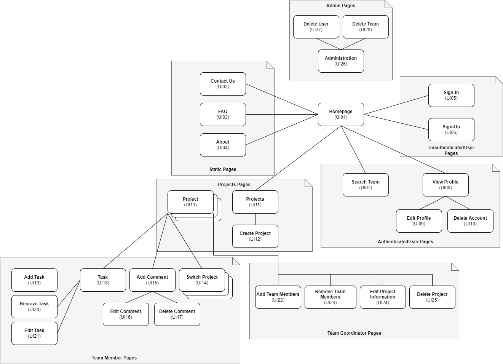

# A3: Information Architecture

This artifact compacts the system information we are developing. The main goals are:

1.Identifying and describing the user requirements, and raise new ones

2.Preview and empirically test the user interface of the product to be developed.

3.Enable quick and multiple iterations on the design of the user interface.

This artifact includes two elements:

1.A sitemap, defining how the information is organized in pages.

2.A set of wireframes, defining the functionality and the content for each page. Wireframes are designed for at least two of the most important pages.

## 1. Sitemap

A sitemap is a visual representation of the relationship between the different pages of a website that shows how all the information fits together.

The DreamTask system is organized in seven main areas, the static pages that provide general information about the system (Static Pages), the individual unauthenticated user page (Unauthenticated User Pages), the pages with administration features (Admin Pages), the workspace page (Project Pages), the authenticated user pages (Authenticated User), the responsible for the team members' project pages (Team Coordinator Pages) and the team members' pages (Team Member Pages) .

Figure 1: DreamTask Sitemap

## 2. Wireframes

Wireframe is a prototype used in interface design to suggest the structure of a website and the connection between its pages. A wireframe web is a similar illustration of the layout of fundamental elements in the interface.

## 2.1 Authenticated User Page

Figure 2: Authenticated User Wireframe

1. Application Info
2. User Area
3. Menu
4. Search Bar

## 2.2 Unauthenticated User Page

Figure 3: Unauthenticated User Wireframe

1. Application Info
2. Login Area
3. Menu
4. Search Bar

## 2.3 Login Page

Figure 4: Login Wireframe

1. Application Info
2. Login Area
3. Sign Up Area
4. Search Bar

## 2.4 User Tasks Page

Figure 5: User Tasks Wireframe

1. Application Info
2. User Area
3. Search Bar
4. Task Board
5. Project Info
6. All Tasks
